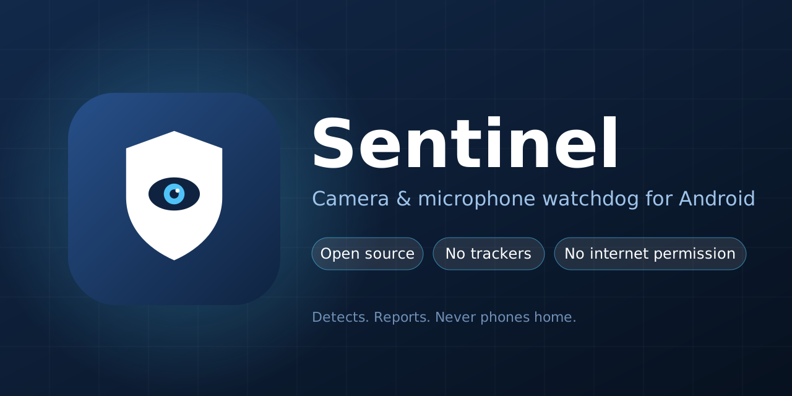

<p align="center">
  
</p>

<p align="center">
  <a href="https://github.com/Ciprian-LocalPulse/privacy-sentinel/actions/workflows/build.yml"></a>
  <a href="https://github.com/Ciprian-LocalPulse/privacy-sentinel/actions/workflows/codeql.yml"></a>
  <a href="LICENSE"></a>
  
  
</p>

# Sentinel — camera & microphone watchdog for Android

Sentinel tells you **when your camera or microphone is used, by whom (best guess), and whether it happened while your screen was off**. Free, open source, no internet permission.

> Romanian version: [README.ro.md](README.ro.md)

## What it does
- **Live log** of every camera / microphone start and stop, with timestamp.
- **"Suspicious" flag** + high-priority alert when the camera or mic turns on while the screen is off (phone calls and VoIP calls are excluded).
- **Probable app** shown for each event (optional "Usage access" permission; this is a heuristic: the app last in the foreground).
- **App audit**: which installed apps can use camera / microphone, whether the permission is currently granted, one tap to its settings page.
- Shortcut to the system privacy settings (Android 12+ camera / mic switches).
- Starts again after reboot if you enabled it.

## What it does NOT do (read this)
Sentinel is a **detector, not a shield**. It uses public Android APIs only, so:

- It cannot block access by other software, by the OS vendor, or by system-level spyware.
- Anything with root/system privileges, or a compromised OS, can hide from it.
- Attributing an event to an app is a best guess, not proof.
- Camera detection relies on camera "availability" callbacks; some devices also report the camera as busy for non-app reasons, so occasional false positives are possible.
- Microphone detection relies on `AudioRecordingCallback`; the information other apps' recordings expose is limited by Android and may vary by device/version.

If you need hardware-level guarantees, look at devices with physical kill switches. For the strongest software-level privacy, look at hardened OSes such as GrapheneOS. Sentinel complements them; it does not replace them.

## Privacy
- **No `INTERNET` permission** (check `app/src/main/AndroidManifest.xml`). The app cannot send anything anywhere.
- No analytics, no ads, no third-party SDKs.
- The log lives in the app's private storage and is excluded from backups.

## Requirements
Android 8.0+ (API 26). Notifications permission on Android 13+.

## Build
Requirements: JDK 17 and Android Studio (or the Android SDK).

```bash
git clone https://github.com/Ciprian-LocalPulse/privacy-sentinel.git
cd privacy-sentinel
# Open in Android Studio and press Run, or:
gradle :app:assembleDebug
```
APK: `app/build/outputs/apk/debug/app-debug.apk`

GitHub Actions builds a debug APK on every push. Pushing a tag like `v0.1.0` attaches it to a GitHub Release.

### Signed release build
```bash
keytool -genkeypair -v -keystore release.jks -alias sentinel -keyalg RSA -keysize 4096 -validity 10000
gradle :app:assembleRelease
# then sign with apksigner (Android SDK build-tools)
```
Never commit your keystore (it is in `.gitignore`).

## Project layout
```
app/src/main/java/org/privacysentinel/app/
  MainActivity.kt          Compose UI (Log / Apps / Settings tabs)
  MonitorService.kt        Foreground service: camera + mic callbacks
  EventStore.kt            Local SQLite log
  ForegroundAppResolver.kt Probable-app heuristic (UsageStats)
  PermissionAuditor.kt     Lists apps with camera/mic permissions
  Notifier.kt              Notification channels and alerts
  BootReceiver.kt          Restart after reboot
```

## Roadmap ideas
- Export log as CSV/JSON (user-initiated)
- Quick-settings tile to toggle monitoring
- More languages
- Optional Shizuku support for exact app attribution via AppOps (still no root)
- F-Droid metadata


## Documentation
| Document | What it covers |
|---|---|
| [Whitepaper (PDF)](docs/Sentinel-Whitepaper.pdf) / [Markdown](docs/WHITEPAPER.md) | Problem, design, privacy and security analysis |
| [Threat model](docs/THREAT_MODEL.md) | Who Sentinel can and cannot detect |
| [Test plan](docs/TESTING.md) | Manual tests and a device results table (contributions welcome) |
| [Privacy policy](PRIVACY_POLICY.md) | Exactly what data is handled and why each permission exists |
| [Security policy](SECURITY.md) | How to report vulnerabilities, how to verify releases |
| [Third-party notices](THIRD_PARTY_NOTICES.md) | Open-source dependencies and their licenses |
| [Changelog](CHANGELOG.md) | Release history |

## Status
Early version (0.1.0). The code has been written and reviewed but **not yet validated across many devices**.
Please test it on your phone and report results using the [test plan](docs/TESTING.md).

## Verify a download
Releases include `SHA256SUMS.txt`. CI also fails the build if the APK ever contains the `INTERNET` permission.
```bash
aapt dump permissions app-debug.apk   # should not list android.permission.INTERNET
```

## Contributing / Security
See [CONTRIBUTING.md](CONTRIBUTING.md), [CODE_OF_CONDUCT.md](CODE_OF_CONDUCT.md) and [SECURITY.md](SECURITY.md).

## License
MIT — see [LICENSE](LICENSE).
