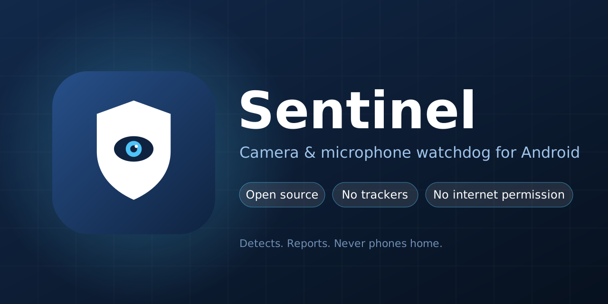

<p align="center">
  
</p>

# Sentinel — cine folosește camera și microfonul telefonului tău

Sentinel îți arată **când sunt folosite camera sau microfonul, de către ce aplicație (estimare) și dacă s-a întâmplat cu ecranul stins**. Gratuit, open source, fără permisiune de internet.

> English version: [README.md](README.md)

## Ce face
- **Jurnal live** cu fiecare pornire / oprire a camerei și microfonului.
- **Marcaj „Suspect”** + alertă când camera sau microfonul pornesc cu ecranul stins (apelurile telefonice și VoIP sunt excluse).
- **Aplicația probabilă** pentru fiecare eveniment (permisiune opțională „Acces la utilizare”; este o estimare: ultima aplicație aflată în prim-plan).
- **Audit aplicații**: ce aplicații pot folosi camera / microfonul, dacă permisiunea este acordată acum, un tap până la setările lor.
- Scurtătură către setările de confidențialitate ale sistemului (comutatoarele pentru cameră / microfon, Android 12+).
- Pornește din nou după repornirea telefonului, dacă l-ai activat.

## Ce NU face (citește)
Sentinel este un **detector, nu un scut**. Folosește doar API-uri publice Android, deci:

- Nu poate bloca accesul altui software, al producătorului sistemului sau al spyware-ului cu privilegii de sistem.
- Orice are drepturi root/sistem sau un OS compromis se poate ascunde de el.
- Atribuirea unui eveniment unei aplicații este o estimare, nu o dovadă.
- Detectarea camerei se bazează pe notificările de disponibilitate; pe unele telefoane camera poate fi raportată ocupată și din alte motive, deci pot apărea alarme false.
- Detectarea microfonului se bazează pe `AudioRecordingCallback`; informațiile despre înregistrările altor aplicații sunt limitate de Android și pot varia după telefon/versiune.

Pentru garanții la nivel de hardware, caută telefoane cu întrerupătoare fizice. Pentru cea mai bună protecție software, uită-te la sisteme întărite precum GrapheneOS. Sentinel le completează, nu le înlocuiește.

## Confidențialitate
- **Fără permisiunea `INTERNET`** (verifică `app/src/main/AndroidManifest.xml`). Aplicația nu poate trimite nimic nicăieri.
- Fără analitice, reclame sau SDK-uri externe.
- Jurnalul rămâne în stocarea privată a aplicației și este exclus din backup.

## Cerințe
Android 8.0+ (API 26). Permisiunea de notificări pe Android 13+.

## Compilare
Ai nevoie de JDK 17 și Android Studio.

```bash
git clone https://github.com/Ciprian-LocalPulse/privacy-sentinel.git
cd privacy-sentinel
# Deschide în Android Studio și apasă Run, sau:
gradle :app:assembleDebug
```
APK: `app/build/outputs/apk/debug/app-debug.apk`

GitHub Actions compilează automat un APK la fiecare push. Un tag de forma `v0.1.0` îl atașează la un Release.


## Documentație
- [Whitepaper (PDF)](docs/Sentinel-Whitepaper.pdf), în engleză, cu rezumat în română
- [Model de amenințări](docs/THREAT_MODEL.md)
- [Plan de testare](docs/TESTING.md)
- [Politica de confidențialitate](PRIVACY_POLICY.md)
- [Politica de securitate](SECURITY.md)
- [Notificări terți](THIRD_PARTY_NOTICES.md)
- [Istoric versiuni](CHANGELOG.md)

## Stare
Versiune timpurie (0.1.0). Codul a fost scris și verificat, dar **încă nu a fost validat pe multe telefoane**. Te rog să-l încerci și să raportezi rezultatele folosind [planul de testare](docs/TESTING.md).

## Verifică o descărcare
Fiecare Release include `SHA256SUMS.txt`. CI-ul respinge automat orice build al cărui APK conține permisiunea `INTERNET`.

## Licență
MIT — vezi [LICENSE](LICENSE).
