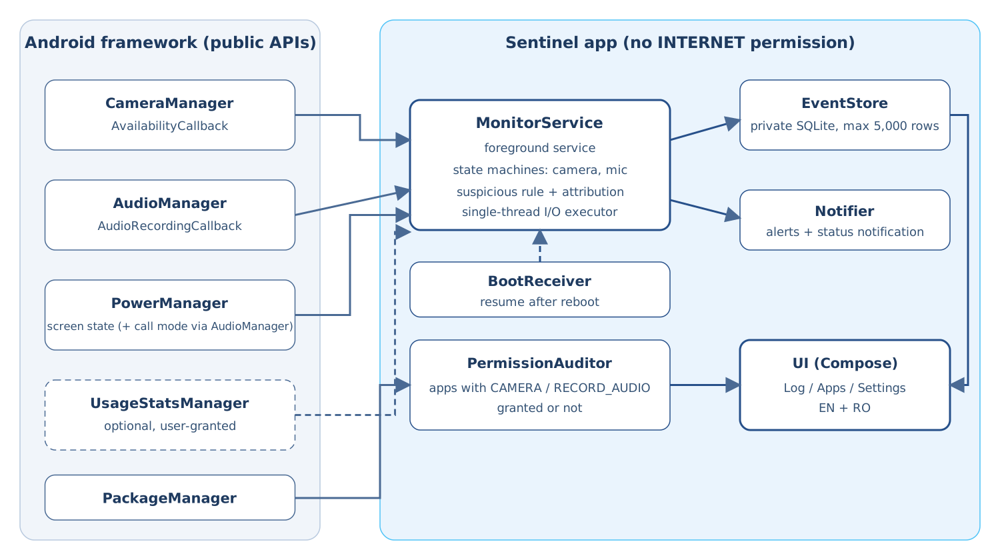

# Sentinel: A Transparent, Offline Watchdog for Camera and Microphone Use on Android

**Whitepaper v1.0 · Software version 0.1.0 · 23 November 2026**
**Author:** Ciprian-LocalPulse · **License:** MIT · **Repository:** github.com/Ciprian-LocalPulse/privacy-sentinel

---

## Abstract

Smartphones carry a camera and a microphone everywhere their owners go. Modern Android versions show indicators when these sensors are active and offer system-wide switches, but the user gets no durable record of what happened while they were not looking. Sentinel is a free, open-source Android application that fills this gap. It observes camera and microphone activity through public Android APIs only, records every start and stop in a private local log, flags use that occurs while the screen is off, and audits which installed apps hold the relevant permissions. Sentinel has no internet permission, so nothing it learns can leave the device.

This paper describes the problem, the threat model, the design, and the privacy and security properties of Sentinel. It is explicit about limits: Sentinel is a detector, not a shield. It cannot block access, and it cannot see activity hidden by system-level or hardware-level adversaries. Empirical validation across devices has not yet been performed; a test plan is provided so that it can be done in the open.

**Rezumat (română).** Sentinel este o aplicație Android gratuită și open source care înregistrează local când sunt folosite camera și microfonul, marchează folosirea cu ecranul stins și arată ce aplicații au permisiunile respective. Nu are permisiune de internet, deci nimic nu părăsește telefonul. Este un detector, nu un scut: nu poate bloca accesul și nu poate vedea activitatea ascunsă de software cu privilegii de sistem sau de hardware. Validarea pe dispozitive reale nu este încă făcută; planul de testare este inclus.

---

## 1. Introduction and motivation

A phone's camera and microphone are among the most sensitive sensors a person owns. They can reveal conversations, locations, faces and routines. Over the last several Android releases, the platform has added runtime permissions, on-screen indicators and system toggles. These are valuable, but they share a limit: they are **ephemeral**. An indicator is visible only while the user is looking at the screen at the right moment. A short recording made while the phone is in a pocket, or in the middle of the night, leaves no trace the user can inspect later.

Many people also install apps whose need for camera or microphone access is unclear, and rarely revisit the permissions they granted. Finally, people who fear targeted surveillance, for example in an abusive relationship, have few accessible tools to check their own device.

Sentinel's contribution is modest and concrete: a **durable, private, understandable record** of sensor activity and a **review** of who is allowed to cause it, using nothing beyond what Android officially exposes to ordinary apps.

## 2. Goals and non-goals

**Goals**
1. Show when the camera or microphone becomes active or inactive, with timestamps.
2. Highlight use that is unlikely to be intended by the owner (screen off, not a call).
3. Give a best-effort indication of which app was responsible.
4. Let the user review which apps hold camera or microphone permission and jump to their settings.
5. Keep all data on the device and make this verifiable by anyone.
6. Be simple enough to audit in an afternoon.

**Non-goals**
1. Preventing or blocking sensor access.
2. Defeating system-level, firmware or hardware adversaries.
3. Inspecting the content of audio, video, messages or files.
4. Network monitoring or traffic analysis.
5. Replacing hardened operating systems or hardware kill switches.

## 3. Background: how Android exposes sensor use

Android controls sensor access with runtime permissions (`CAMERA`, `RECORD_AUDIO`). Recent releases add an on-screen indicator while a sensor is in use and quick toggles to disable the camera or microphone for all apps. Background access is restricted: on recent versions an app generally needs to be visible, or run a foreground service of the matching type, to use these sensors.

Two public framework APIs are relevant to an observer app:

- **`CameraManager.AvailabilityCallback`** notifies registered apps when a camera device becomes unavailable (for example, because another app opened it) and available again. It does not name the other app.
- **`AudioManager.AudioRecordingCallback`** notifies registered apps when the set of active audio recordings changes. For recordings made by other apps, Android deliberately limits the details exposed to unprivileged callers, so the observer learns that recording is active, not necessarily who is recording.

Two further public APIs support context: **`PowerManager.isInteractive`** (is the screen on) and **`AudioManager.getMode`** (is a call in progress), and the optional **`UsageStatsManager`**, which with a user-granted special permission reveals which app was last in the foreground.

Sentinel is built from exactly these pieces and nothing else.

## 4. Threat model

The complete model is in [THREAT_MODEL.md](THREAT_MODEL.md). In summary:

| Adversary | Example | Sentinel's coverage |
|---|---|---|
| A1: ordinary app with permission | A game that records more than it should | Detects, usually |
| A2: stalkerware with elevated app-level rights | Hidden "monitoring" app | Mostly detects use; does not stop it |
| A3: root, system or vendor spyware, compromised OS | Kernel-level spyware | No guarantee |
| A4: firmware, baseband, hardware | Backdoored modem or microphone path | None |
| A5: physical access to unlocked phone | A person with the phone | Partial: shows past use, but can be uninstalled |

The crucial residual risk is **false reassurance**: an empty log does not prove safety against A3 and A4. For that reason the application states its limits on its own Settings screen, and this paper repeats them.

## 5. System design

### 5.1 Components

- **MonitorService** is a foreground service (type `specialUse`, with a persistent notification). It registers the camera and audio callbacks and owns the detection logic.
- **EventStore** is a private SQLite database holding the event log, capped at 5,000 rows, with a change counter that lets the UI refresh.
- **Notifier** manages the monitoring notification and alert notifications.
- **ForegroundAppResolver** implements the optional attribution heuristic.
- **PermissionAuditor** lists apps that request `CAMERA` or `RECORD_AUDIO` and whether each is currently granted.
- **BootReceiver** restarts monitoring after a reboot if the user had enabled it.
- **UI** is a single-activity Jetpack Compose application with three tabs (Log, Apps, Settings), in English and Romanian.

### 5.2 Detection

**Camera.** Sentinel keeps the set of camera IDs currently reported unavailable. When the set changes from empty to non-empty, a `camera/start` event is recorded; when it returns to empty, `camera/stop`. Sentinel never opens the camera itself.

**Microphone.** Sentinel registers for audio recording changes. When the list of active recordings goes from empty to non-empty, `mic/start` is recorded; the reverse yields `mic/stop`. The state at service start is read but not logged, so that only changes are recorded.

### 5.3 The "suspicious" rule

A start event is flagged suspicious when **the screen is not interactive** at that moment, **unless** the sensor is the microphone and the audio mode indicates a phone or communication call. The rule is intentionally simple and explainable. It will produce false positives (for example, scheduled voice recorders) and false negatives (hostile use while the screen is on); it is a prompt for the user to look, not a verdict.

### 5.4 Probable-app attribution

If the user grants Usage access, Sentinel queries recent usage events and returns the package whose last event was "moved to foreground" with no later "moved to background". This answers "which app was on screen" and not "which app opened the sensor". It is labelled "Probably" in the UI for that reason.

### 5.5 Permission audit

The auditor reads each installed package's requested permissions and their granted flags. Apps are sorted so those currently holding camera or microphone permission appear first. Each row links to the system's per-app settings page, where the user can revoke permissions. This feature requires the `QUERY_ALL_PACKAGES` permission, which is why distribution through the Google Play Store would require a policy justification; GitHub and F-Droid distribution do not.

### 5.6 Threading and resilience

Callbacks run on the main thread and capture screen and call state immediately. Database writes, usage queries and notification posting run on a single background executor, so a slow query cannot block the callbacks. The service is `START_STICKY` and restarts after reboot via `BootReceiver`.

## 6. Privacy and security analysis

**Data minimization.** The log holds only: timestamp, sensor, start/stop, screen state, a suspicious flag, and optionally a package name. No audio, image, location, contact or message data is ever read.

**No exfiltration channel.** The manifest does not declare `INTERNET`. Without it Android denies the app network sockets. This is verifiable by anyone with a single command (`aapt dump permissions`) and is enforced in continuous integration, which fails the build if the permission appears.

**Storage.** Data lives in app-private storage. Cloud backup and device-to-device transfer are excluded; `allowBackup` is false.

**Attack surface.** Only the launcher activity is exported. The service and the boot receiver are not exported. There is no content provider, no exported intent handler, no web view and no deserialization of external data.

**Permissions.** Each permission is justified in the [privacy policy](../PRIVACY_POLICY.md). The riskiest ones (`PACKAGE_USAGE_STATS`, `QUERY_ALL_PACKAGES`) are either optional and user-granted, or used solely for the audit feature.

**Supply chain.** Dependencies are limited to AndroidX, Jetpack Compose and the Kotlin standard library. Dependabot tracks updates, CodeQL scans the code, and releases carry SHA-256 checksums.

**Integrity of the log.** The log is not tamper-proof against the device owner or a privileged attacker. This is a deliberate non-goal.

## 7. Limitations

1. **Detector, not shield.** Sentinel cannot block or terminate anything.
2. **Adversary coverage.** Root, system-level and hardware adversaries are out of reach (Section 4).
3. **OEM behaviour.** Some manufacturers aggressively kill background apps. Events during such gaps are lost. Users should exempt Sentinel from battery optimization. Gap detection is planned.
4. **Camera false positives.** A camera may be reported unavailable for reasons other than a third-party app opening it.
5. **Microphone attribution.** Android limits what unprivileged apps learn about other apps' recordings.
6. **Heuristic attribution.** The foreground app is not necessarily the one using the sensor.
7. **Pre-start activity.** Sensor use that began before the service started is not logged.
8. **Not yet validated.** At the time of writing, the application has been written and reviewed but has not been systematically tested across devices and Android versions.

## 8. Evaluation plan

Validation will follow the manual plan in [TESTING.md](TESTING.md), run on a range of manufacturers and Android versions, with results contributed publicly. Planned metrics:

- **Detection rate:** fraction of known camera/microphone sessions that produce start and stop events.
- **Latency:** time between sensor activation and log entry.
- **False-positive rate:** events flagged suspicious that the tester identifies as legitimate.
- **Reliability:** events lost after extended idle periods on different OEM builds.
- **Battery cost:** drain attributable to the service over 24 hours.

No quantitative results are claimed in this version. Claims in this paper are limited to design properties that follow directly from the code and documentation of the public APIs.

## 9. Related approaches

| Approach | Strength | Weakness relative to Sentinel's niche |
|---|---|---|
| OS indicators and sensor toggles | Built in, authoritative | Ephemeral; no history |
| Hardened OS (for example GrapheneOS) | Strong isolation, prevention | Requires specific hardware and a reinstall |
| Hardware kill switches | Physical guarantee | Requires special hardware |
| Permission managers | Review and revoke | No record of actual use |
| **Sentinel** | History, offline, any Android 8+ phone | Detects only; cannot see below the OS |

Sentinel is designed to be used **alongside** these, not instead of them.

## 10. Responsible use and ethics

Sentinel is meant for monitoring **one's own device**. It does not record or reveal anyone's content, and it contains no feature for covertly watching other people. The code of conduct prohibits using the project to promote stalkerware. Because the app has no network access, it cannot be turned into a remote surveillance tool by adding a server component without publicly changing its manifest, which would be visible to anyone reviewing it.

## 11. Roadmap

- Gap detection and a warning when the service was not running.
- Quick-settings tile to toggle monitoring.
- User-initiated export (CSV/JSON).
- Optional Shizuku integration for precise attribution via AppOps, without root.
- Additional languages.
- F-Droid distribution and reproducible builds.
- Community-contributed device test matrix.

## 12. Conclusion

Sentinel offers a small, auditable answer to a real gap: a durable record of when sensors were used and a review of who may use them. Its strength is not power but **honesty and verifiability**: public APIs only, no network access, open code, and clearly stated limits. Its value will be settled by testing on real devices, which this project invites.

## References

1. Android Developers. *CameraManager.AvailabilityCallback*. developer.android.com/reference/android/hardware/camera2/CameraManager.AvailabilityCallback
2. Android Developers. *AudioManager.AudioRecordingCallback*. developer.android.com/reference/android/media/AudioManager.AudioRecordingCallback
3. Android Developers. *UsageStatsManager*. developer.android.com/reference/android/app/usage/UsageStatsManager
4. Android Developers. *PowerManager* and *AudioManager* class references. developer.android.com
5. Android Open Source Project. source.android.com
6. GrapheneOS. grapheneos.org
7. Contributor Covenant 2.1. contributor-covenant.org
8. Keep a Changelog; Semantic Versioning. keepachangelog.com, semver.org

*This document describes the design of Sentinel 0.1.0 and will be updated as the software and its validation evolve. Feedback and corrections are welcome through the repository's issues.*
